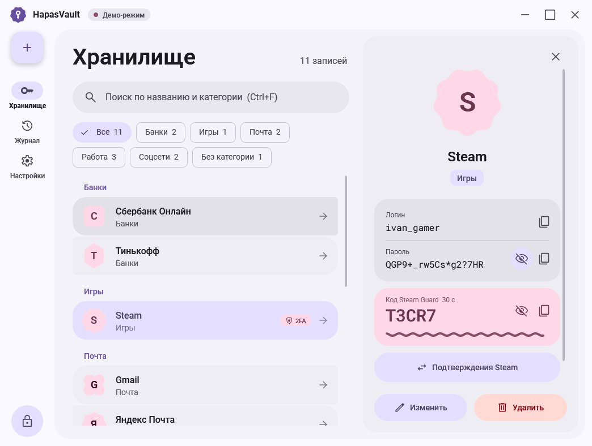
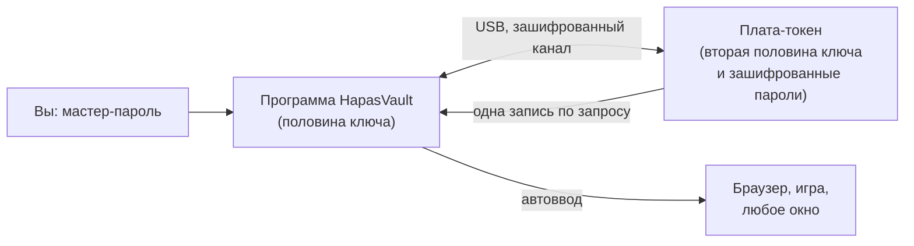
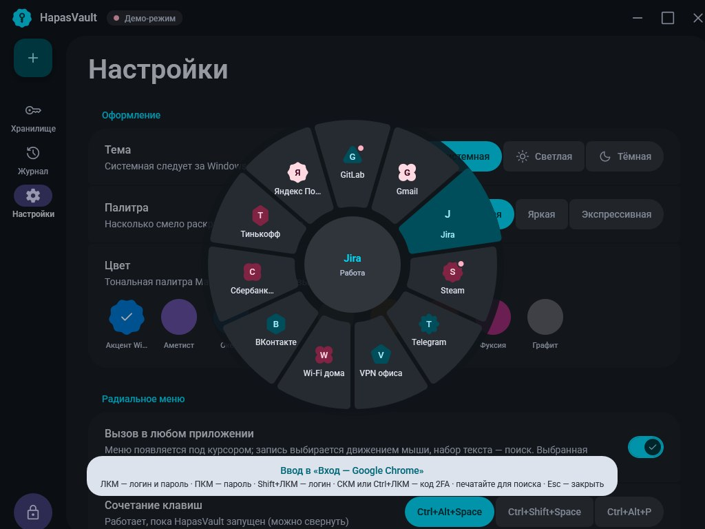
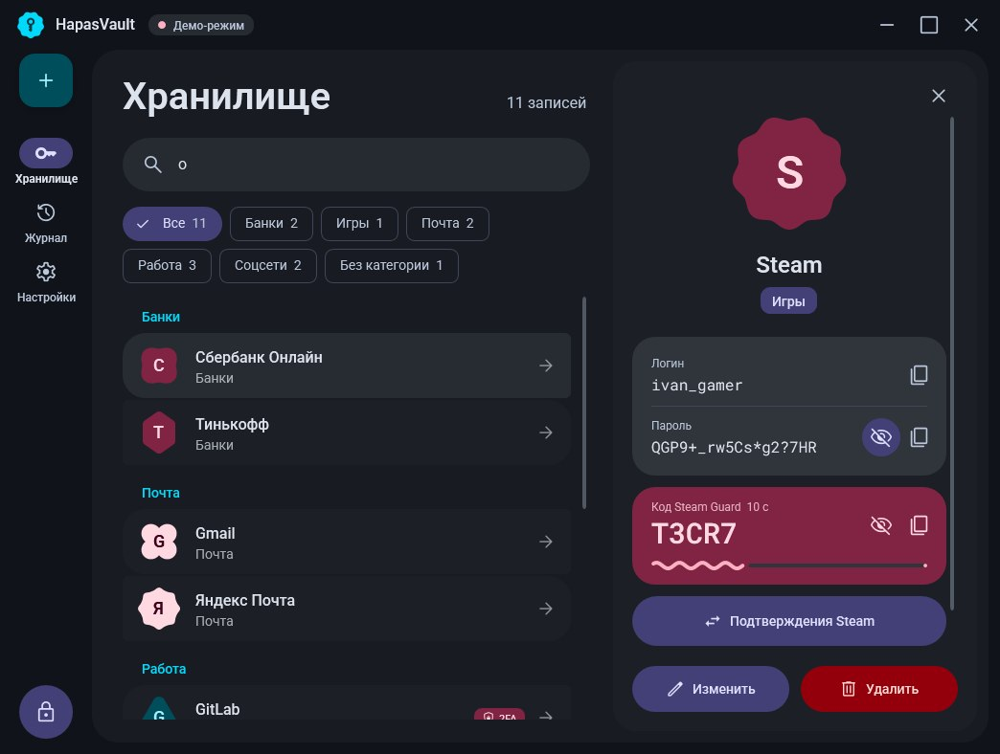
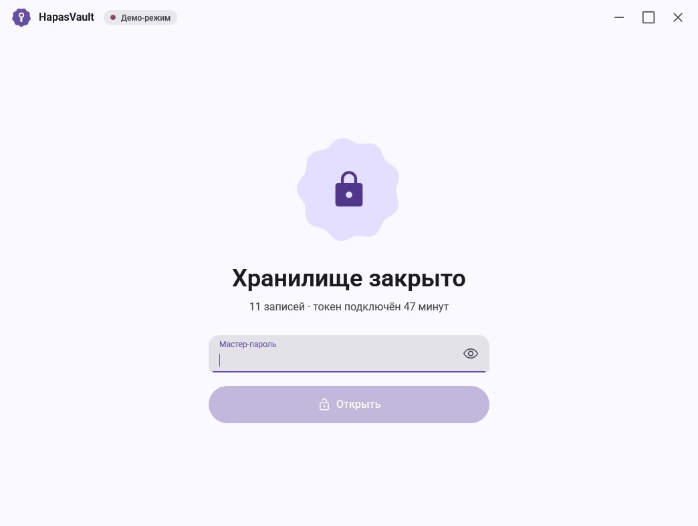
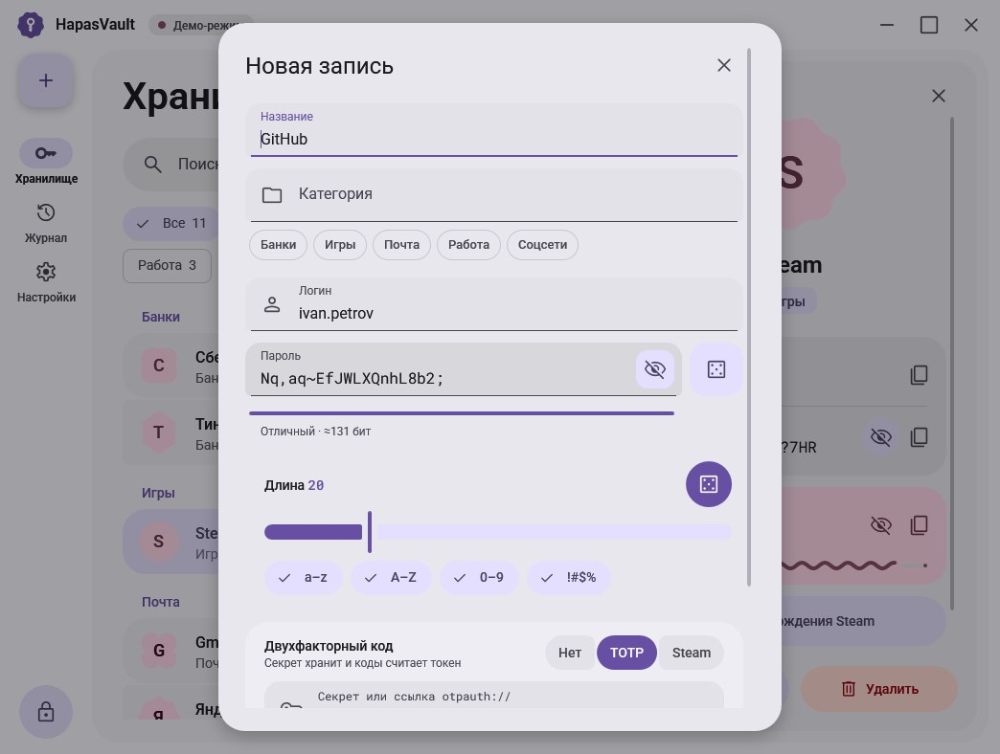
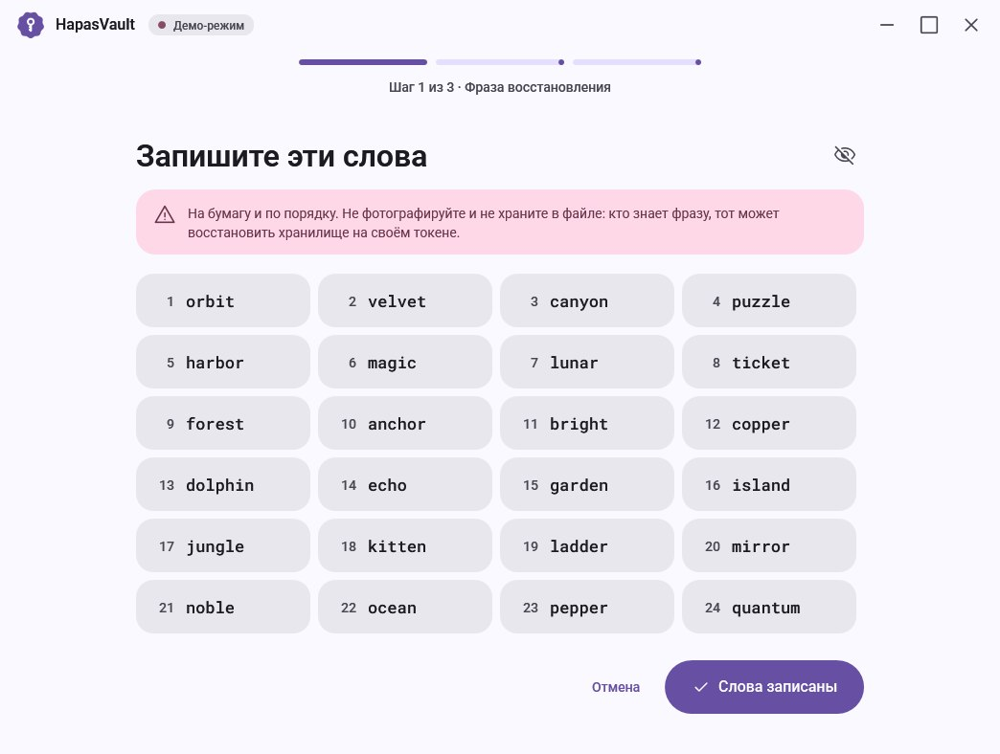
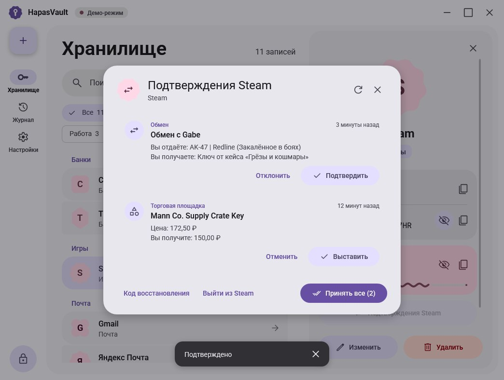
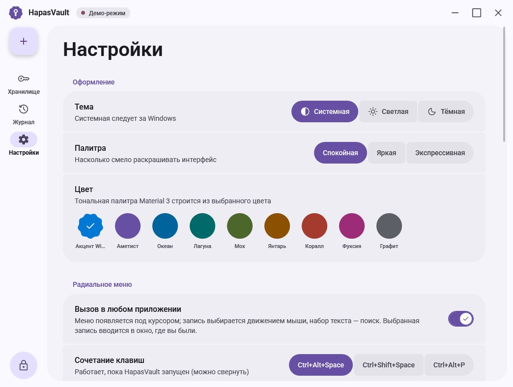

# HapasVault

**Ваши пароли живут на маленькой USB-плате, а не в облаке и не на диске компьютера.**

HapasVault — менеджер паролей с аппаратным ключом. Плата Raspberry Pi Pico
(или похожая, стоит несколько сотен рублей) превращается в токен, который
хранит и расшифровывает пароли сам. Программа для Windows — удобный интерфейс
к нему: поиск, автоввод в любое окно, коды двухфакторной защиты и подтверждения
Steam.



## Зачем это

| Обычный менеджер паролей | HapasVault |
|---|---|
| база паролей — файл на диске или в облаке; украли файл и подобрали пароль — получили всё | база зашифрована **на плате**; файл с компьютера без платы бесполезен |
| пароль расшифровывается на компьютере целиком | плата отдаёт компьютеру **одну** запись по запросу и не больше 10 в минуту |
| секрет двухфакторной защиты хранится рядом с паролем | секрет 2FA **никогда не покидает плату** — она сама считает коды |
| нужна подписка или доверие к сервису | всё локально, без интернета и аккаунтов; код открыт |

Чтобы прочитать пароли, нужно **всё сразу**: сама плата, ваш компьютер (на нём
вторая половина ключа) и мастер-пароль. Вынули плату — хранилище закрылось.

## Как это работает



1. При первом запуске программа и плата вместе создают ключ и показывают
   **24 слова** — их записывают на бумагу. Это запасной ключ на случай потери
   платы или компьютера.
2. Вы придумываете **мастер-пароль**. Он нужен каждый раз, чтобы открыть
   хранилище.
3. Дальше — как с обычным менеджером паролей, только расшифровка происходит
   на плате, а светодиод показывает, открыто ли хранилище.

## Что понадобится

* **Плата** — любая из трёх:
  * Raspberry Pi Pico (RP2040);
  * Raspberry Pi Pico 2 (RP2350) — вмещает больше записей и быстрее;
  * Waveshare RP2040-Zero — самая маленькая, с цветным светодиодом.
* **Компьютер** с Windows 10 или 11 (64-бит).
* **10 минут** и лист бумаги для 24 слов.

Ни паять, ни ставить драйверы не нужно.

## Установка

Всё скачивается со страницы [Releases](https://github.com/HouwyTwitch/hapasvault/releases/latest).

1. **Прошейте плату.** Скачайте прошивку для своей платы:
   * `pmtoken-pico.uf2` — Pico;
   * `pmtoken-pico2.uf2` — Pico 2;
   * `pmtoken-rp2040-zero.uf2` — RP2040-Zero.

   Зажмите на плате кнопку **BOOT** (BOOTSEL), подключите её к компьютеру и
   отпустите кнопку. Появится диск `RPI-RP2` (у Pico 2 — `RP2350`). Скопируйте
   на него файл `.uf2`. Плата перезагрузится и станет токеном.
2. **Запустите программу.** Распакуйте `HapasVault-<версия>-win64.zip` в любую
   папку и запустите `HapasVault.exe`. Установка и права администратора не
   нужны.
3. **Настройте токен.** Программа сама найдёт плату и проведёт по шагам:
   покажет 24 слова, проверит, что вы их записали, и попросит мастер-пароль.
4. **Сделайте резервную копию.** Настройки → «Сохранить копию». Без неё
   24 слова вернут доступ, но не сами записи. Файл копии зашифрован, его можно
   хранить где угодно. Обновляйте копию, когда добавили что-то важное.

Хотите сначала посмотреть? Кнопка «Демо без токена» на первом экране
(мастер-пароль в демо — `demo`).

## Каждый день

**Ввод пароля в любом окне.** Нажмите `Ctrl+Alt+Space` — под курсором
появится круговое меню. Ведите мышь к нужной записи:

* левая кнопка — логин, Tab, пароль, Enter;
* правая — только пароль;
* Shift + левая — только логин;
* колесо или Ctrl + левая — код двухфакторной защиты.

Можно просто начать печатать название — включится поиск. Если хранилище
закрыто, меню сначала спросит мастер-пароль.



**Коды двухфакторной защиты (2FA).** В записи откройте раздел
«Двухфакторный код» и вставьте ссылку `otpauth://` из QR-кода сайта или секрет.
Для Steam подойдёт `shared_secret` или весь maFile Steam Desktop
Authenticator. Коды видны в карточке записи и вводятся из кругового меню.

**Подтверждения Steam.** Если вставить в запись весь maFile, в карточке
появится кнопка «Подтверждения Steam»: обмены, лоты торговой площадки и прочее,
с кнопками «Подтвердить», «Отклонить» и «Принять все». После импорта maFile
можно удалить с диска: секреты уже на плате. Если провайдер не пускает к
Steam — Настройки → Steam → прокси.

**Работа в фоне.** Крестик сворачивает программу в трей — горячая клавиша
продолжает работать. В настройках можно включить «Запускать вместе с Windows».

**Блокировка.** Хранилище закрывается само: если вынуть плату, после 5 минут
бездействия, при блокировке Windows и перед сном. Вручную — `Ctrl+L` или
замок внизу слева. Скопированный пароль стирается из буфера через 30 секунд.

## Светодиод на плате

| Pico / Pico 2 | RP2040-Zero | Что значит |
|---|---|---|
| короткая вспышка раз в 3 с | тусклая синяя вспышка раз в 2 с | ждёт программу |
| вспышка раз в секунду | синяя вспышка раз в секунду | связь с программой есть, хранилище закрыто |
| горит | горит зелёным | хранилище открыто |
| часто мигает | часто мигает красным | ошибка |

## Несколько компьютеров и плат

* **Второй компьютер (до 4).** Установите программу и подключите плату —
  программа увидит, что плата уже настроена, и попросит 24 слова. Записи
  остаются на плате, мастер-пароль тот же.
* **Отвязать компьютер.** Настройки → «Компьютеры этого токена» → «Отвязать».
  Отвязанный компьютер больше не получит доступ, даже если с него украли файлы.
* **Запасная плата.** Настройки → «Дублировать на новый токен»: программа
  перенесёт все записи на чистую плату. Нужны 24 слова и мастер-пароль.
  Платы не синхронизируются — копия на момент дублирования.
* **Несколько плат на одном компьютере (до 4).** Программа сама понимает,
  какая вставлена.

## Если что-то случилось

<details>
<summary><b>Потерял или сломал плату</b></summary>

Возьмите новую плату, прошейте её, запустите программу и выберите
восстановление: введите 24 слова, мастер-пароль и укажите файл резервной копии.
Все записи из копии вернутся. Без копии восстановится доступ, но хранилище
будет пустым. Найденная кем-то старая плата без вашего компьютера и пароля
бесполезна.
</details>

<details>
<summary><b>Сменил или потерял компьютер</b></summary>

Установите программу на новый компьютер и подключите плату — она попросит
24 слова. Затем отвяжите старый компьютер: Настройки → «Компьютеры этого
токена».
</details>

<details>
<summary><b>Забыл мастер-пароль</b></summary>

Восстановить его нельзя: пароль — часть ключа, и даже резервная копия без него
не откроется. По 24 словам можно начать заново с новым паролем, но записи
пропадут. Поэтому выбирайте пароль, который запомните, и не храните его рядом
с платой.
</details>

<details>
<summary><b>Потерял 24 слова</b></summary>

Пока плата и компьютер живы, всё работает как раньше. Но если потеряете плату
или компьютер, вернуть доступ будет нечем. Пока есть доступ, заведите новую
плату с новыми словами и перенесите записи на неё вручную.
</details>

<details>
<summary><b>Как обновиться</b></summary>

Программа сама сообщает о новой версии. Скачайте новый архив и прошейте плату
новым `.uf2` тем же способом, что при установке — записи на плате сохраняются.
Программа и прошивка должны быть из одного релиза: при несовпадении программа
так и скажет.
</details>

<details>
<summary><b>Хочу убедиться, что плата исправна</b></summary>

В архиве есть `tools\pmhwtest.exe`. На **новой** плате он проверяет все
функции и стирает её обратно. Настроенную плату он не трогает.
</details>

<details>
<summary><b>Как проверить, что скачанный файл настоящий</b></summary>

Каждый файл релиза подписан через Sigstore при сборке на GitHub. Проверка
(нужен [GitHub CLI](https://cli.github.com)):
```
gh attestation verify HapasVault-1.0.72-win64.zip -R HouwyTwitch/hapasvault
```
Подделанный или собранный в другом месте файл проверку не пройдёт.
</details>

## Насколько это безопасно

Пароли расшифровываются только на плате, связь с ней зашифрована, перебор
мастер-пароля замедляется с каждой ошибкой, а секреты 2FA и Steam плату не
покидают. Подробнее — в [SECURITY.md](SECURITY.md) и
[docs/HOW-IT-WORKS.md](docs/HOW-IT-WORKS.md).

Честно о границах:

* Если на компьютере вирус, работающий от вашего имени, пока хранилище открыто,
  он может видеть то же, что и вы. Такой компьютер не спасёт ни один менеджер
  паролей; плата лишь ограничивает, сколько он успеет вытащить.
* На плате пока нет кнопки подтверждения действий.
* Тот, кто держит плату в руках, может считать её flash или перепрошить её.
  Пароли там зашифрованы, и без вашего компьютера и мастер-пароля они
  бесполезны. У Pico 2 (RP2350) есть защищённая загрузка, но в прошивке она
  пока не включена.
* Программа — только для Windows 10/11.
* В памяти платы помещается 1–3 тысячи обычных записей (Pico 2 — больше).
  Сколько занято — Настройки → «Память токена».

## Ещё скриншоты

| | |
|---|---|
|  |  |
|  |  |
|  |  |

## Для разработчиков

* [docs/DEVELOPMENT.md](docs/DEVELOPMENT.md) — сборка, тесты, эмулятор
  прошивки, CI и релизы;
* [docs/HOW-IT-WORKS.md](docs/HOW-IT-WORKS.md) — ключи, протокол, разметка
  flash, политики токена;
* [SECURITY.md](SECURITY.md) — модель угроз и результаты аудита.

## Лицензия

Свободное ПО под GNU GPL версии 3 или более поздней, см. [LICENSE](LICENSE).
Это относится к программе, библиотеке, утилитам и прошивке: распространяя
изменённую версию, вы обязаны открыть её исходный код под той же лицензией.
Сторонние компоненты — в [gui/THIRD_PARTY.md](gui/THIRD_PARTY.md).
