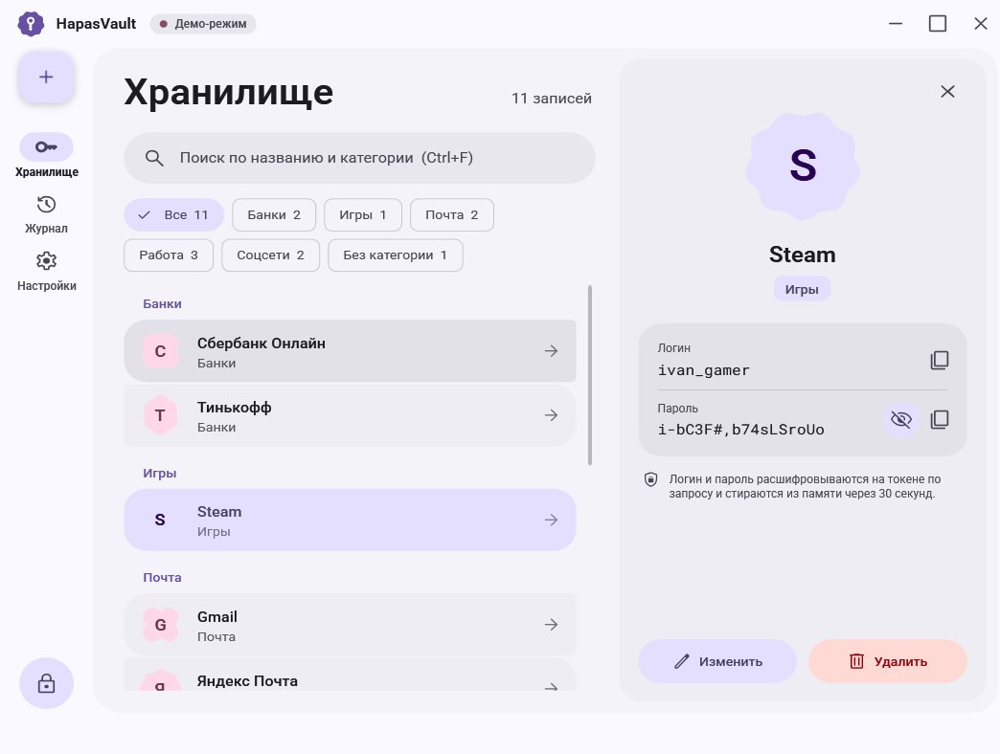
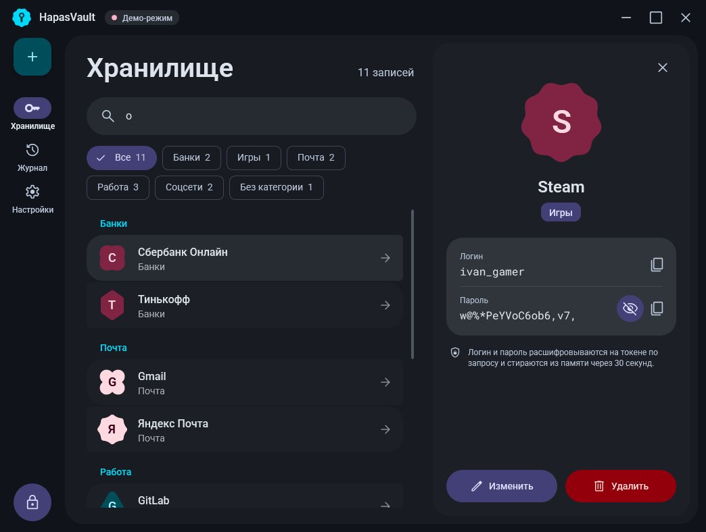
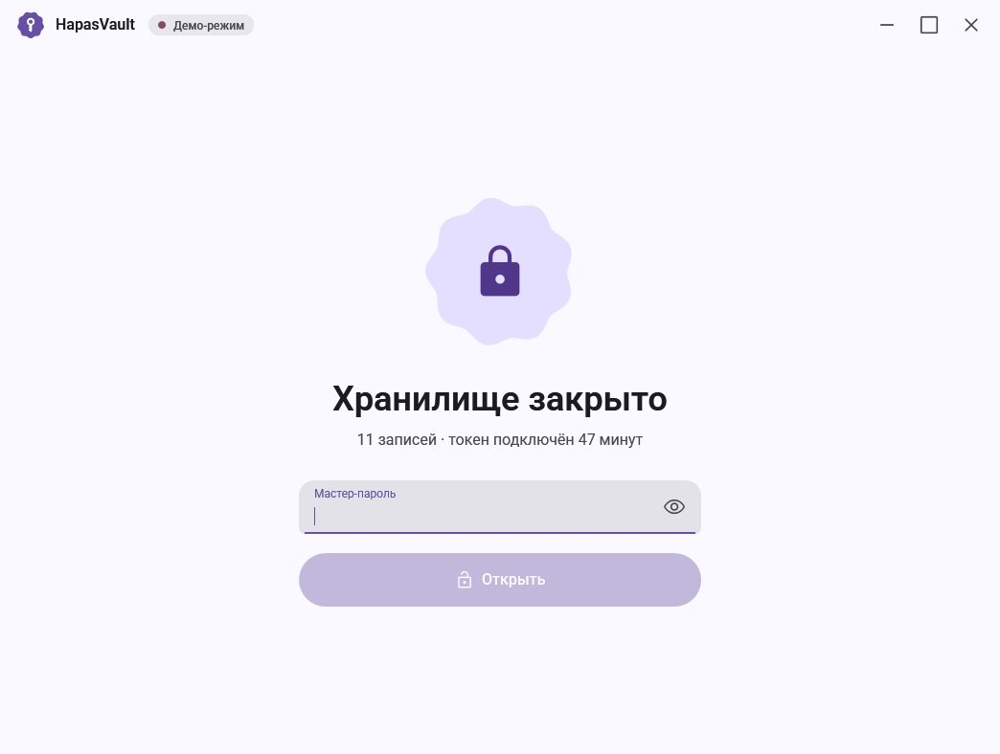
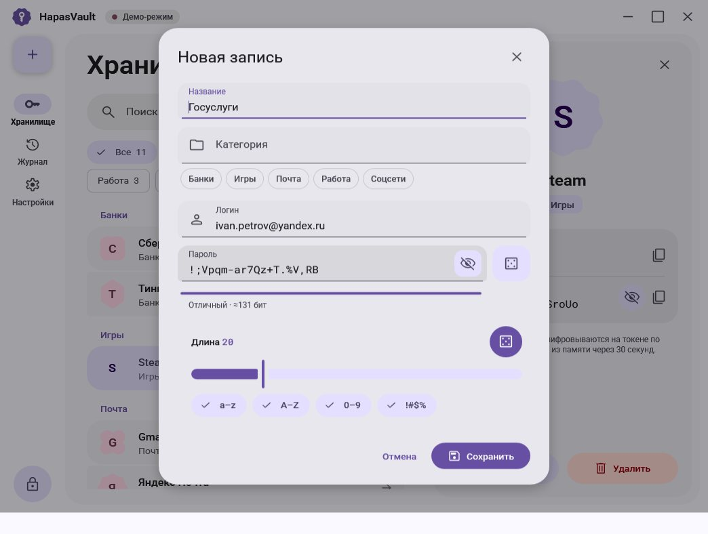
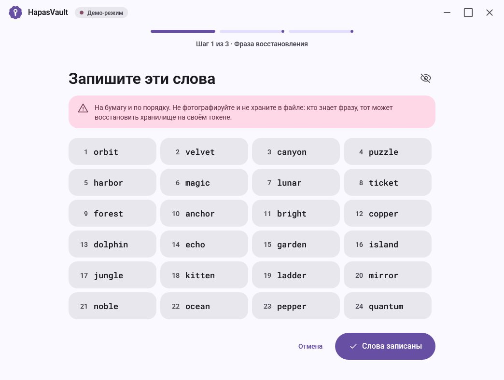
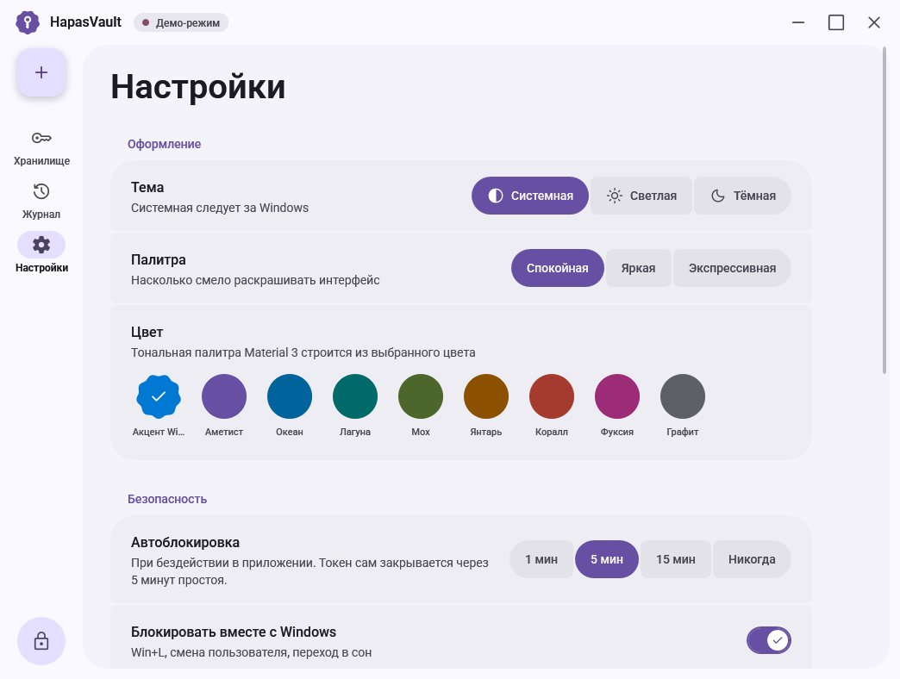
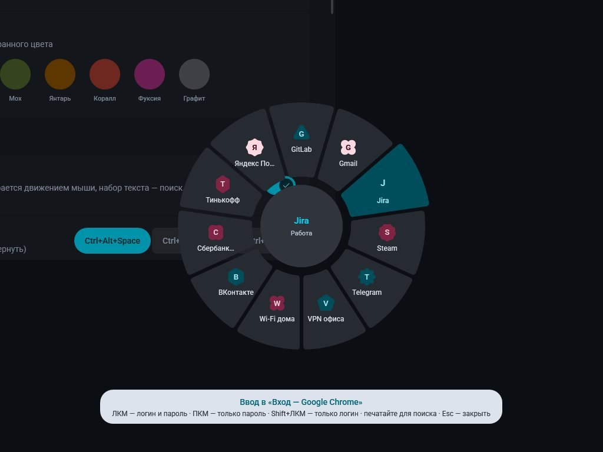
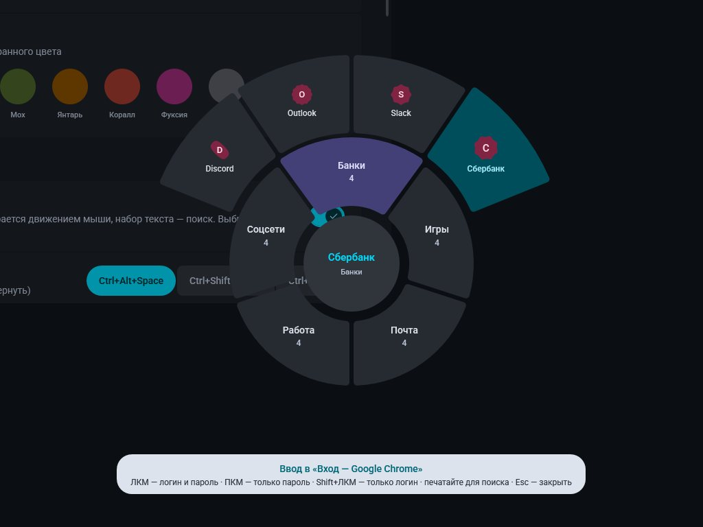

# hapasvault

HArdware PASswords VAult — аппаратный менеджер паролей на RP2040 (pmtoken)
и приложение HapasVault для Windows в стиле Material 3 Expressive.

## Готовая сборка под Windows

GitHub Actions (`.github/workflows/build.yml`) на каждый push собирает всё под
Windows x64, гоняет тесты и, если всё зелёное, **сам публикует релиз**
на странице Releases (архив `HapasVault-<версия>-win64.zip` и `SHA256SUMS.txt`):

```
HapasVault.exe        приложение (self-contained: .NET и WPF внутри, ставить ничего не нужно)
pmapi.dll             клиентская библиотека токена (C, статический CRT)
tools/pmtoken_sim.exe виртуальный токен
tools/pmcli.exe       консольный клиент
tools/pmhwtest.exe    проверка платы-токена по USB
```

Там же артефакт `screenshots` — все экраны приложения, отрисованные в CI.
На Linux тесты ядра идут под AddressSanitizer/UBSan, тесты C#-клиента — против
настоящего симулятора на обеих ОС.

В релизе также прошивки `pmtoken-pico.uf2` и `pmtoken-pico2.uf2` (см. ниже).

**Проверка подлинности.** Каждый файл релиза получает подписанную через Sigstore
запись о происхождении (SLSA provenance): из какого репозитория, коммита и
workflow он собран. Сертификата не нужно — подпись привязана к OIDC-токену
сборки GitHub Actions. Проверить скачанный файл:
```
gh attestation verify HapasVault-0.4.57-win64.zip -R HouwyTwitch/hapasvault
gh attestation verify pmtoken-pico.uf2 -R HouwyTwitch/hapasvault
```
Подделанный или пересобранный в другом месте файл проверку не пройдёт.

Какой релиз получается:

| Событие | Релиз |
|---|---|
| push в `main` | `v<VERSION>.<номер сборки>`, например `v0.4.57`, помечается последним |
| push тега `v1.2.3` | `v1.2.3` |
| push в любую другую ветку | предрелиз `dev` — всегда последняя сборка, перезаписывается |

Мажорная и минорная версии задаются в файле `VERSION`. Программа при запуске
сверяется с последним стабильным релизом и предлагает обновиться (выключается
в настройках; предрелизы не предлагаются). Если в секретах репозитория заданы
`SIGN_PFX_BASE64` и `SIGN_PFX_PASSWORD`, `HapasVault.exe` и `pmapi.dll`
подписываются Authenticode — тогда SmartScreen перестаёт предупреждать.

| | |
|---|---|
|  |  |
|  |  |
|  |  |
|  |  |

### Радиальное меню и автоввод

`Ctrl+Alt+Space` в любом приложении — поверх экрана открывается радиальное
меню, курсор встаёт в его центр. Запись выбирается **направлением** мыши:

* до 12 записей — одно кольцо со всеми записями;
* больше — внутреннее кольцо категорий; куда ведёте мышь, там снаружи
  веером раскрываются записи этой категории;
* начните печатать — поиск, Enter вводит первое совпадение.

ЛКМ — логин ⇥ пароль ⏎, ПКМ — только пароль, Shift+ЛКМ — только логин,
СКМ или Ctrl+ЛКМ — код 2FA.
Запись расшифровывается на токене и набирается в окно, где вы были
(события клавиатуры Unicode — раскладка не важна). Если хранилище закрыто,
меню сначала спросит мастер-пароль. В окна, запущенные от администратора,
Windows не даёт вводить — тогда значение копируется в буфер обмена.
Сочетание и Enter после ввода меняются в настройках.

### Двухфакторные коды: TOTP и Steam Guard

В редакторе записи — раздел «Двухфакторный код». Вставьте ссылку `otpauth://`
(из QR-кода), секрет Base32, а для Steam — `shared_secret` или весь maFile
Steam Desktop Authenticator. Секрет уходит на токен один раз и больше никогда
не выдаётся: когда нужен код, программа присылает токену текущее время, а токен
возвращает только сам код. Код виден в карточке записи с отсчётом до смены,
копируется и вводится из радиального меню (СКМ или Ctrl+ЛКМ). Время не может
обогнать часы токена больше чем на 5 минут, поэтому заранее набрать коды
«на будущее» нельзя.

### Безопасность

Модель угроз, устройство защиты и результаты аудита — в [SECURITY.md](SECURITY.md).

### Попробовать приложение

1. Запустите `tools\pmtoken_sim.exe` (виртуальный токен; flash — файл рядом).
2. Запустите `HapasVault.exe`: найдёт токен, предложит сопряжение и настройку.

Без токена: кнопка «Демо без токена» или `HapasVault.exe --demo`
(мастер-пароль в демо — `demo`).

## Приложение HapasVault (`gui/`)

```
gui/HapasVault.Core/        C#-обёртка над pmapi: TokenClient, ошибки, генератор паролей, BIP39
gui/HapasVault.Core.Tests/  интеграционные тесты против pmtoken_sim
gui/HapasVault/             WPF-приложение
  Theming/   динамический цвет M3: тональные палитры (тон = L*, оттенок — OKLCH),
             светлая/тёмная тема, акцент Windows, стили палитры
  Motion/    пружинные и emphasized-кривые
  Controls/  формы M3 Expressive с морфингом, индикатор загрузки, волнистый прогресс,
             кнопки с морфингом формы, ripple, поле пароля
  Themes/    стили контролов, типографика (Roboto), иконки (Material Symbols)
  Views/     экраны и диалоги (DataTemplate)
  ViewModels/ логика экранов (CommunityToolkit.Mvvm)
client/pmapi.c              C ABI для P/Invoke: непрозрачный хэндл, таймаут сокета
```

Что умеет: поиск токена, сопряжение, мастер настройки (24 слова,
проверка трёх, мастер-пароль с оценкой стойкости), восстановление из слов и
резервной копии, блокировка, хранилище с поиском, фильтрами по категориям и
группами, генератор паролей, журнал токена, резервная копия, сброс токена.

Безопасность интерфейса:
* логин и пароль запрашиваются у токена только по действию пользователя и
  стираются из памяти интерфейса через 30 секунд;
* скопированный пароль не попадает в журнал буфера Win+V и облачный буфер,
  буфер очищается через 30 секунд;
* автоблокировка при бездействии, при блокировке Windows и перед сном;
* пока хранилище открыто, приложение не опрашивает токен — иначе токен не смог
  бы закрыться по простою;
* ключ ПК (`%APPDATA%\HapasVault\pmclient.id`) защищён DPAPI.

Горячие клавиши: Ctrl+Alt+Space — радиальное меню (глобально), Ctrl+N — новая запись, Ctrl+F — поиск, Ctrl+L — заблокировать,
Esc — закрыть диалог или панель.

Сборка вручную (нужны .NET 8 SDK и сборка CMake в `build/`):
```
cmake -S . -B build -A x64 && cmake --build build --config Release
dotnet test gui/HapasVault.Core.Tests -c Release
dotnet publish gui/HapasVault/HapasVault.csproj -c Release -r win-x64 --self-contained -p:PublishSingleFile=true -o publish
```

## Прошивка для Raspberry Pi Pico

В каждом релизе есть готовые прошивки: `pmtoken-pico.uf2` (Pico, RP2040) и
`pmtoken-pico2.uf2` (Pico 2, RP2350). Прошить:

1. Зажмите кнопку **BOOTSEL** и подключите плату к USB — появится диск `RPI-RP2`
   (у Pico 2 — `RP2350`).
2. Скопируйте на него `.uf2`. Плата перезагрузится и станет токеном.
3. Запустите HapasVault: в режиме подключения «Авто» (по умолчанию) он сам
   найдёт токен. Драйвер не нужен — это стандартный USB CDC (COM-порт).

Перед тем как доверить токену пароли, прогоните проверку на чистой плате
(`tools/pmhwtest.exe` из архива): сопряжение, все команды, OTP, запись во flash,
блокировка при отключении. В конце плата стирается обратно.
```
pmhwtest            найдёт токен сам
pmhwtest COM5       или явный порт
```

Светодиод на плате:

| | |
|---|---|
| редкая вспышка раз в 3 с | ждёт программу |
| вспышка раз в секунду | сессия установлена, хранилище закрыто |
| горит | хранилище открыто |
| часто мигает 1,5 с | ошибка (подмена кадра, сбой flash) |

Время операций на Pico (RP2040, 125 МГц), по счётчику тактов в эмуляторе:
установка сессии ~0,4 с (четыре X25519 на Cortex-M0+), остальные команды
5–60 мс, плюс ~0,4 с на стирание flash у команд, меняющих хранилище. RP2350
(Cortex-M33, 150 МГц) быстрее в несколько раз.

**USB-идентификатор.** Сейчас `1209:0001` — тестовый PID pid.codes, его можно
использовать только для разработки. Для своих плат получите PID на
[pid.codes](https://pid.codes) (бесплатно для открытого железа) и поменяйте
`PM_USB_VID/PM_USB_PID` в `core/proto.h`: клиент и прошивка берут их оттуда.

Сборка (нужны `gcc-arm-none-eabi` и pico-sdk 2.1.1):
```
cmake -S firmware -B build-fw -DPICO_SDK_PATH=~/pico-sdk -DPICO_BOARD=pico   # или pico2
cmake --build build-fw          # -> build-fw/pmtoken.uf2
```

```
firmware/
  main.c            главный цикл: USB CDC <-> token_handle, сброс DTR = блокировка
  hal_rp2040.c      flash (последние 80 КБ), RNG, время, светодиод
  usb_descriptors.c USB CDC, серийный номер = уникальный ID платы
  emu/              запуск прошивки в эмуляторе RP2040 (rp2040js) для CI
```

**Проверка без платы.** CI запускает собранную прошивку в эмуляторе RP2040
([rp2040js](https://github.com/wokwi/rp2040js)): исполняется настоящий ARM-код
вместе с TinyUSB, а USB CDC эмулятора проброшен на TCP-порт. Тот же `pmhwtest`
проходит по нему весь сценарий. Локально:
```
cd firmware/emu && npm ci && node emu.js ../../build-fw/pmtoken.uf2 47300
pmhwtest tcp:47300
```

Память RP2040: 201 КБ RAM из 264 (один 40-килобайтный буфер кадра на запрос и
ответ, хранилище в RAM — 32 КБ), стек ~2,2 КБ из 4, flash прошивки — 69 КБ.

## Токен (pmtoken)

Ядро токена — один и тот же код в прошивке, виртуальном токене и тестах.

```
core/        ядро токена — тот же код в прошивке RP2040/RP2350
  hal.h        5 функций железа: flash, RNG, время, светодиод
  token.c      команды, состояние, лимиты, журнал
  store.c      flash: конфигурация и хранилище, A/B-копии
  session.c    зашифрованный канал (рукопожатие KK + XChaCha20-Poly1305)
  kdf.c        вывод ключей
  bip39.c      24 слова восстановления
  sha.c, otp.c SHA-1/SHA-256/HMAC, TOTP и Steam Guard
  framer.c     сборка кадров из потока байт (USB CDC)
  proto.h      протокол: кадры, команды, статусы, USB VID/PID
firmware/    прошивка для Pico и Pico 2 (см. выше)
sim/         виртуальный токен: TCP 127.0.0.1:47123 или --pty, flash = файл
client/      библиотека ПК (pmclient), транспорты TCP и USB CDC; pmapi — DLL для GUI
tools/       pmcli — консольный клиент; pmhwtest — проверка платы
tests/       228 автотестов и фаззер pmfuzz
third_party/ Monocypher 4 (X25519, XChaCha20-Poly1305, BLAKE2b, Argon2id)
```

## Сборка на Windows

Нужны CMake и один из компиляторов.

**Visual Studio 2022** (Developer PowerShell):
```
cmake -S . -B build
cmake --build build --config Release
build\Release\pmtests.exe
```

**MSYS2 / MinGW-w64:**
```
cmake -S . -B build -G "MinGW Makefiles" -DCMAKE_BUILD_TYPE=Release
cmake --build build
build\pmtests.exe
```

> Windows-ветки (Winsock, BCryptGenRandom, DPAPI, `_getch`) собираются в CI
> на MSVC и проходят те же тесты.

## Попробовать

Окно 1 — виртуальный токен:
```
pmtoken_sim token_flash.bin
```
Окно 2 — клиент:
```
pmcli
> pair        сопряжение
> setup       24 слова, проверка трёх из них, мастер-пароль
> add         добавить запись
> list        список без паролей
> get 1       логин и пароль одной записи
> backup vault.bak
> quit        = «выдернуть токен», хранилище блокируется
```
Повторный запуск `pmcli` сам установит сессию, останется `unlock`.

Восстановление «на новой плате»: остановите симулятор, удалите `token_flash.bin`
и `pmclient.id`, запустите заново и выполните `pair`, затем `restore vault.bak`.

## Ключи

```
seed     = BLAKE2b(rand_token || rand_pc)            -> 24 слова BIP39
K_token  = KDF(seed, "k_token")                       хранится на токене
K_pc     = KDF(seed, "k_pc")                          хранится на ПК (DPAPI)
pw_hash  = Argon2id(мастер-пароль, соль из K_pc)      64 МиБ, 3 прохода, на ПК
K_vault  = KDF(K_token, K_pc || pw_hash)              только в RAM токена
```

* Seed складывается из случайности обеих сторон: слабый RNG RP2040 не страшен,
  и ПК не может подсунуть заранее известный seed.
* Seed не сохраняется нигде, кроме вашей бумаги.
* Расшифровка идёт **на токене**; ПК получает только одну запрошенную запись.
  Команды «выгрузить всё» нет. `backup` отдаёт только шифротекст.

## Что лежит на flash токена

| Данные | Вид |
|---|---|
| статический ключ X25519 токена, публичный ключ ПК, K_token | открыто (без K_pc и пароля бесполезны) |
| записи (категории, названия, логины, пароли) | XChaCha20-Poly1305, ключ K_vault |

Тест проверяет, что в дампе flash нет ни паролей, ни названий, ни K_pc.

## Канал ПК <-> токен

* Сопряжение один раз: обмен статическими ключами X25519, без действий на
  устройстве. Токен доверяет первому ПК (trust on first use) и, пока сопряжён,
  отказывает остальным (только после `reset`).
* Каждая сессия: рукопожатие по схеме Noise KK (эфемерные ключи, четыре DH).
  Даёт forward secrecy и взаимную аутентификацию. Чужой ПК получает отказ на
  первом же кадре.
* Кадры: XChaCha20-Poly1305 со счётчиком. Повтор, перестановка или подмена
  рвут сессию.

## Встроенные политики (`core/token.h`)

| Политика | Значение |
|---|---|
| таймаут простоя | 5 мин → блокировка и закрытие сессии |
| отключение USB | немедленная блокировка, ключи стираются из RAM |
| лимит расшифровок | 10 в минуту |
| неверный пароль | 3 попытки без задержки, затем 1, 2, 4 … с, не больше часа; счётчик во flash |
| коды 2FA | 30 в минуту; время ПК не может обогнать часы токена больше чем на 5 мин |
| журнал | последние 32 операции (в RAM, до перезагрузки), только при открытом хранилище |
| ёмкость | 32 КБ открытого текста, это ~200–300 записей |

## Разметка flash (80 КБ из 4 МБ)

```
сектор 0     конфигурация A
сектор 1     конфигурация B
2..10        хранилище, слот A (36 КБ)
11..19       хранилище, слот B (36 КБ)
```
Запись всегда идёт в слот со старой копией, у каждой копии есть счётчик и
контрольная сумма. Выдёргивание во время записи откатывает к предыдущей версии
(есть тест).

## Дальше

1. Проверить прошивку на живой плате (`pmhwtest`) и получить свой USB PID.
2. Импорт QR-кода 2FA с экрана; подтверждения Steam (identity_secret).
