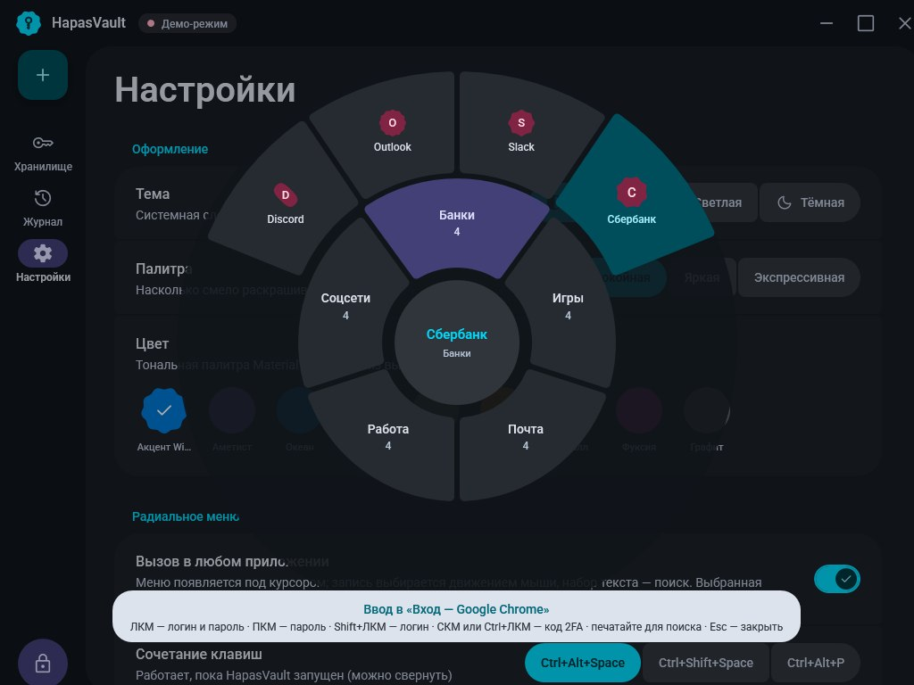
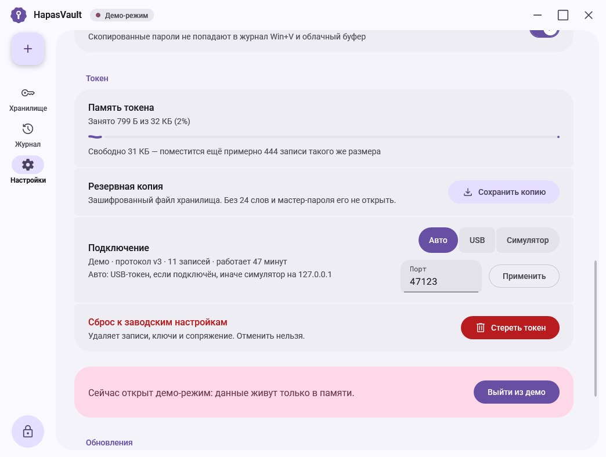

# hapasvault

HArdware PASswords VAult — аппаратный менеджер паролей на RP2040 (pmtoken)
и приложение HapasVault для Windows в стиле Material 3 Expressive.

## Быстрый старт

1. **Плата.** Raspberry Pi Pico или Pico 2. Скачайте `pmtoken-pico.uf2` /
   `pmtoken-pico2.uf2` со страницы Releases, зажмите BOOTSEL, подключите плату
   и скопируйте файл на появившийся диск.
2. **Проверка платы** (рекомендуется): `tools\pmhwtest.exe` из архива —
   прогоняет все функции на чистой плате и стирает её обратно.
3. **Программа.** Распакуйте `HapasVault-<версия>-win64.zip`, запустите
   `HapasVault.exe`. Установка и права администратора не нужны.
4. **Сопряжение и настройка.** Программа найдёт токен, сопряжёт с этим ПК,
   покажет 24 слова — запишите их на бумаге — и попросит мастер-пароль.
5. **Резервная копия.** Настройки → «Сохранить копию». Без неё 24 слова
   восстановят доступ, но не записи.

Программа и прошивка должны быть из одного релиза: при несовпадении программа
так и скажет. Обновления программа проверяет сама (отключается в настройках);
прошивку обновляют тем же способом, что в п. 1 — записи на плате сохраняются.

## Готовая сборка под Windows

GitHub Actions (`.github/workflows/build.yml`) на каждый push собирает всё под
Windows x64, гоняет тесты и, если всё зелёное, **сам публикует релиз**
на странице Releases (архив `HapasVault-<версия>-win64.zip` и `SHA256SUMS.txt`):

```
HapasVault.exe        приложение (self-contained: .NET и WPF внутри, ставить ничего не нужно)
pmapi.dll             клиентская библиотека токена (C, статический CRT)
tools/pmtoken_sim.exe виртуальный токен
tools/pmcli.exe       консольный клиент
tools/pmhwtest.exe    проверка платы-токена по USB
```

Там же артефакт `screenshots` — все экраны приложения, отрисованные в CI.
На Linux тесты ядра идут под AddressSanitizer/UBSan, тесты C#-клиента — против
настоящего симулятора на обеих ОС.

В релизе также прошивки `pmtoken-pico.uf2` и `pmtoken-pico2.uf2` (см. ниже).

**Проверка подлинности.** Каждый файл релиза получает подписанную через Sigstore
запись о происхождении (SLSA provenance): из какого репозитория, коммита и
workflow он собран. Сертификата не нужно — подпись привязана к OIDC-токену
сборки GitHub Actions. Проверить скачанный файл:
```
gh attestation verify HapasVault-1.0.60-win64.zip -R HouwyTwitch/hapasvault
gh attestation verify pmtoken-pico.uf2 -R HouwyTwitch/hapasvault
```
Подделанный или пересобранный в другом месте файл проверку не пройдёт.

Какой релиз получается:

| Событие | Релиз |
|---|---|
| push в `main` | `v<VERSION>.<номер сборки>`, например `v1.0.60`, помечается последним |
| push тега `v1.2.3` | `v1.2.3` |
| push в любую другую ветку | предрелиз `dev` — всегда последняя сборка, перезаписывается |

Мажорная и минорная версии задаются в файле `VERSION`. Программа при запуске
сверяется с последним стабильным релизом и предлагает обновиться (выключается
в настройках; предрелизы не предлагаются). Если в секретах репозитория заданы
`SIGN_PFX_BASE64` и `SIGN_PFX_PASSWORD`, `HapasVault.exe` и `pmapi.dll`
подписываются Authenticode — тогда SmartScreen перестаёт предупреждать.

| | |
|---|---|
|  |  |
|  |  |
|  |  |
|  |  |
|  |  |

### Несколько компьютеров и токенов

* **Ещё один компьютер.** Установите HapasVault, подключите токен — программа
  увидит, что он уже настроен, и попросит 24 слова. Хранилище открывается тем
  же мастер-паролем, записи остаются на токене. До 4 компьютеров на токен.
* **Управление.** Настройки → «Компьютеры этого токена»: имена всех привязанных
  ПК и кнопка «Отвязать» — отвязанный ПК больше не получит доступ, даже если
  его файл ключа украден.
* **Несколько токенов.** Один компьютер знает до 4 токенов и сам понимает,
  какой вставлен. Список и «Забыть» — Настройки → «Токены этого компьютера».
* **Дублирование.** Настройки → «Дублировать на новый токен»: копия читается в
  память, вы меняете плату на чистую, программа привязывает её и записывает
  копию. Нужны 24 слова и мастер-пароль. Синхронизации между токенами нет —
  копия на момент дублирования.

### Работа в трее

Крестик сворачивает HapasVault в область уведомлений: горячая клавиша
радиального меню и автоблокировка продолжают работать. Значок в трее, на панели
задач и в Alt+Tab — тот же знак, что в заголовке окна, в цветах выбранной
палитры. Выход — правой кнопкой по значку; повторный запуск программы просто
показывает окно. Отключается в Настройки → Работа в фоне.

### Радиальное меню и автоввод

`Ctrl+Alt+Space` в любом приложении — поверх экрана открывается радиальное
меню, курсор встаёт в его центр. Запись выбирается **направлением** мыши:

* до 12 записей — одно кольцо со всеми записями;
* больше — внутреннее кольцо категорий; куда ведёте мышь, там снаружи
  веером раскрываются записи этой категории;
* начните печатать — поиск, Enter вводит первое совпадение.

ЛКМ — логин ⇥ пароль ⏎, ПКМ — только пароль, Shift+ЛКМ — только логин,
СКМ или Ctrl+ЛКМ — код 2FA.
Запись расшифровывается на токене и набирается в окно, где вы были
(события клавиатуры Unicode — раскладка не важна). Если хранилище закрыто,
меню сначала спросит мастер-пароль. В окна, запущенные от администратора,
Windows не даёт вводить — тогда значение копируется в буфер обмена.
Сочетание и Enter после ввода меняются в настройках.

### Двухфакторные коды: TOTP и Steam Guard

В редакторе записи — раздел «Двухфакторный код». Вставьте ссылку `otpauth://`
(из QR-кода), секрет Base32, а для Steam — `shared_secret` или весь maFile
Steam Desktop Authenticator. Секрет уходит на токен один раз и больше никогда
не выдаётся: когда нужен код, программа присылает токену текущее время, а токен
возвращает только сам код. Код виден в карточке записи с отсчётом до смены,
копируется и вводится из радиального меню (СКМ или Ctrl+ЛКМ). Время не может
обогнать часы токена больше чем на 5 минут, поэтому заранее набрать коды
«на будущее» нельзя.

### Подтверждения Steam: обмены, торговая площадка, ключ API

Если вставить в запись **весь maFile** Steam Desktop Authenticator, на токен
уйдут `shared_secret`, `identity_secret`, SteamID и код восстановления. В
карточке записи появится кнопка «Подтверждения Steam»: список обменов, лотов
торговой площадки и прочих мобильных подтверждений с кнопками «Подтвердить» и
«Отклонить», а при нескольких — «Принять все».

Кто что делает:

| | Токен | ПК |
|---|---|---|
| `identity_secret`, `shared_secret` | хранит, наружу не выдаёт | — |
| ключ каждого запроса | HMAC-SHA1(identity_secret, время ‖ тег) | присылает время и тег |
| код Steam Guard для входа | считает | — |
| пароль аккаунта | хранит (как любую запись) | получает на время входа |
| код восстановления | хранит, выдаёт по запросу с лимитом и в журнал | показывает 30 с |
| сессия Steam (refresh token) | — | DPAPI, `%APPDATA%\HapasVault\steam` |
| сеть (steamcommunity.com, api.steampowered.com) | — | делает запросы |

Вход в Steam автоматический и устроен как в мобильном Modern-SDA: вход как
браузер, `jwt/finalizelogin` выдаёт cookie сообщества, время сверяется с
серверами Steam. Логин и пароль берутся из записи, код Steam Guard считает токен,
`device_id` берётся из maFile. Если провайдер не пускает к Steam — Настройки →
Steam → прокси и «Проверить связь». Сессия из maFile (новый формат SDA с `RefreshToken`) подхватывается
без входа. Сессия на ПК временная и сама по себе ничего не подтверждает — без
токена ключ подтверждения не получить. Токен выдаёт не больше 30 ключей в минуту,
время не может уйти вперёд его часов больше чем на 5 минут, каждое «подтвердить»
и «отклонить» попадает в журнал токена. После импорта maFile можно удалить с
диска: секреты уже на токене. Как и пароли, они восстанавливаются по 24 словам
только вместе с резервной копией хранилища — сделайте её после импорта.

### Безопасность

Модель угроз, устройство защиты и результаты аудита — в [SECURITY.md](SECURITY.md).

### Попробовать приложение

1. Запустите `tools\pmtoken_sim.exe` (виртуальный токен; flash — файл рядом).
2. Запустите `HapasVault.exe`: найдёт токен, предложит сопряжение и настройку.

Без токена: кнопка «Демо без токена» или `HapasVault.exe --demo`
(мастер-пароль в демо — `demo`).

## Приложение HapasVault (`gui/`)

```
gui/HapasVault.Core/        C#-обёртка над pmapi: TokenClient, ошибки, генератор паролей, BIP39
gui/HapasVault.Core.Tests/  интеграционные тесты против pmtoken_sim
gui/HapasVault/             WPF-приложение
  Theming/   динамический цвет M3: тональные палитры (тон = L*, оттенок — OKLCH),
             светлая/тёмная тема, акцент Windows, стили палитры
  Motion/    пружинные и emphasized-кривые
  Controls/  формы M3 Expressive с морфингом, индикатор загрузки, волнистый прогресс,
             кнопки с морфингом формы, ripple, поле пароля
  Themes/    стили контролов, типографика (Roboto), иконки (Material Symbols)
  Views/     экраны и диалоги (DataTemplate)
  ViewModels/ логика экранов (CommunityToolkit.Mvvm)
client/pmapi.c              C ABI для P/Invoke: непрозрачный хэндл, таймаут сокета
```

Что умеет: поиск токена, сопряжение, мастер настройки (24 слова,
проверка трёх, мастер-пароль с оценкой стойкости), восстановление из слов и
резервной копии, блокировка, хранилище с поиском, фильтрами по категориям и
группами, генератор паролей, журнал токена, резервная копия, сброс токена.

Безопасность интерфейса:
* логин и пароль запрашиваются у токена только по действию пользователя и
  стираются из памяти интерфейса через 30 секунд;
* скопированный пароль не попадает в журнал буфера Win+V и облачный буфер,
  буфер очищается через 30 секунд;
* автоблокировка при бездействии, при блокировке Windows и перед сном;
* пока хранилище открыто, приложение не опрашивает токен — иначе токен не смог
  бы закрыться по простою;
* ключ ПК (`%APPDATA%\HapasVault\pmclient.id`) защищён DPAPI.

Горячие клавиши: Ctrl+Alt+Space — радиальное меню (глобально), Ctrl+N — новая запись, Ctrl+F — поиск, Ctrl+L — заблокировать,
Esc — закрыть диалог или панель.

Сборка вручную (нужны .NET 8 SDK и сборка CMake в `build/`):
```
cmake -S . -B build -A x64 && cmake --build build --config Release
dotnet test gui/HapasVault.Core.Tests -c Release
dotnet publish gui/HapasVault/HapasVault.csproj -c Release -r win-x64 --self-contained -p:PublishSingleFile=true -o publish
```

## Прошивка для Raspberry Pi Pico

В каждом релизе есть готовые прошивки: `pmtoken-pico.uf2` (Pico, RP2040) и
`pmtoken-pico2.uf2` (Pico 2, RP2350). Прошить:

1. Зажмите кнопку **BOOTSEL** и подключите плату к USB — появится диск `RPI-RP2`
   (у Pico 2 — `RP2350`).
2. Скопируйте на него `.uf2`. Плата перезагрузится и станет токеном.
3. Запустите HapasVault: в режиме подключения «Авто» (по умолчанию) он сам
   найдёт токен. Драйвер не нужен — это стандартный USB CDC (COM-порт).

Перед тем как доверить токену пароли, прогоните проверку на чистой плате
(`tools/pmhwtest.exe` из архива): сопряжение, все команды, OTP, запись во flash,
блокировка при отключении. В конце плата стирается обратно.
```
pmhwtest            найдёт токен сам
pmhwtest COM5       или явный порт
```

Светодиод на плате:

| | |
|---|---|
| редкая вспышка раз в 3 с | ждёт программу |
| вспышка раз в секунду | сессия установлена, хранилище закрыто |
| горит | хранилище открыто |
| часто мигает 1,5 с | ошибка (подмена кадра, сбой flash) |

Время операций на Pico (RP2040, 125 МГц), по счётчику тактов в эмуляторе:
установка сессии ~0,4 с (четыре X25519 на Cortex-M0+), остальные команды
5–60 мс, плюс ~0,4 с на стирание flash у команд, меняющих хранилище. RP2350
(Cortex-M33, 150 МГц) быстрее в несколько раз.

**USB-идентификатор.** Сейчас `1209:0001` — общий тестовый PID pid.codes, им
пользуются и другие самодельные устройства. Поэтому программа подключается
только к устройству, которое называет себя `pmtoken` (строка продукта и
интерфейса USB): чужая плата с тем же ID не будет принята за токен. Свой PID
бесплатно дают [pid.codes](https://pid.codes) (открытым проектам, а лицензия
GPL-3.0 подходит) и Raspberry Pi для устройств на своих чипах (VID `2E8A`,
репозиторий `raspberrypi/usb-pid`). Новые значения — в `core/proto.h`:
`PM_USB_VID`, `PM_USB_PID`, `PM_USB_PRODUCT`.

Сборка (нужны `gcc-arm-none-eabi` и pico-sdk 2.1.1):
```
cmake -S firmware -B build-fw -DPICO_SDK_PATH=~/pico-sdk -DPICO_BOARD=pico   # или pico2
cmake --build build-fw          # -> build-fw/pmtoken.uf2
```

```
firmware/
  main.c            главный цикл: USB CDC <-> token_handle, сброс DTR = блокировка
  hal_rp2040.c      flash (всё после 256 КБ прошивки), буфер хранилища, RNG, светодиод
  usb_descriptors.c USB CDC, серийный номер = уникальный ID платы
  emu/              запуск прошивки в эмуляторе RP2040 (rp2040js) для CI
```

**Проверка без платы.** CI запускает собранную прошивку в эмуляторе RP2040
([rp2040js](https://github.com/wokwi/rp2040js)): исполняется настоящий ARM-код
вместе с TinyUSB, а USB CDC эмулятора проброшен на TCP-порт. Тот же `pmhwtest`
проходит по нему весь сценарий. Локально:
```
cd firmware/emu && npm ci && node emu.js ../../build-fw/pmtoken.uf2 47300
pmhwtest tcp:47300
```

Память: всё открытое хранилище при работе лежит в RAM платы (расшифровка только
там), поэтому ёмкость задаёт RAM, а не flash. Прошивке самой нужно ~38 КБ, всю
остальную свободную RAM она отдаёт под хранилище и сообщает итог программе:
**RP2040 — около 195 КБ, RP2350 — около 450 КБ** (это 1–3 тыс. обычных записей).
Flash при этом нужно вдвое больше (две копии), что с запасом есть на любой Pico.
Буфер кадра — 8 КБ: резервная копия и список записей передаются частями.

## Токен (pmtoken)

Ядро токена — один и тот же код в прошивке, виртуальном токене и тестах.

```
core/        ядро токена — тот же код в прошивке RP2040/RP2350
  hal.h        5 функций железа: flash, RNG, время, светодиод
  token.c      команды, состояние, лимиты, журнал
  store.c      flash: конфигурация и хранилище, A/B-копии
  session.c    зашифрованный канал (рукопожатие KK + XChaCha20-Poly1305)
  kdf.c        вывод ключей
  bip39.c      24 слова восстановления
  sha.c, otp.c SHA-1/SHA-256/HMAC, TOTP и Steam Guard
  framer.c     сборка кадров из потока байт (USB CDC)
  proto.h      протокол: кадры, команды, статусы, USB VID/PID
firmware/    прошивка для Pico и Pico 2 (см. выше)
sim/         виртуальный токен: TCP 127.0.0.1:47123 или --pty, flash = файл
client/      библиотека ПК (pmclient), транспорты TCP и USB CDC; pmapi — DLL для GUI
tools/       pmcli — консольный клиент; pmhwtest — проверка платы
tests/       260 автотестов и фаззер pmfuzz
third_party/ Monocypher 4 (X25519, XChaCha20-Poly1305, BLAKE2b, Argon2id)
```

## Сборка на Windows

Нужны CMake и один из компиляторов.

**Visual Studio 2022** (Developer PowerShell):
```
cmake -S . -B build
cmake --build build --config Release
build\Release\pmtests.exe
```

**MSYS2 / MinGW-w64:**
```
cmake -S . -B build -G "MinGW Makefiles" -DCMAKE_BUILD_TYPE=Release
cmake --build build
build\pmtests.exe
```

> Windows-ветки (Winsock, BCryptGenRandom, DPAPI, `_getch`) собираются в CI
> на MSVC и проходят те же тесты.

## Попробовать

Окно 1 — виртуальный токен:
```
pmtoken_sim token_flash.bin
```
Окно 2 — клиент:
```
pmcli
> pair        сопряжение
> setup       24 слова, проверка трёх из них, мастер-пароль
> add         добавить запись
> list        список без паролей
> get 1       логин и пароль одной записи
> backup vault.bak
> quit        = «выдернуть токен», хранилище блокируется
```
Повторный запуск `pmcli` сам установит сессию, останется `unlock`.

Восстановление «на новой плате»: остановите симулятор, удалите `token_flash.bin`
и `pmclient.id`, запустите заново и выполните `pair`, затем `restore vault.bak`.

## Ключи

```
seed     = BLAKE2b(rand_token || rand_pc)            -> 24 слова BIP39
K_token  = KDF(seed, "k_token")                       хранится на токене
K_pc     = KDF(seed, "k_pc")                          хранится на ПК (DPAPI)
pw_hash  = Argon2id(мастер-пароль, соль из K_pc)      64 МиБ, 3 прохода, на ПК
K_vault  = KDF(K_token, K_pc || pw_hash)              только в RAM токена
```

* Seed складывается из случайности обеих сторон: слабый RNG RP2040 не страшен,
  и ПК не может подсунуть заранее известный seed.
* Seed не сохраняется нигде, кроме вашей бумаги.
* Расшифровка идёт **на токене**; ПК получает только одну запрошенную запись.
  Команды «выгрузить всё» нет. `backup` отдаёт только шифротекст.

## Что лежит на flash токена

| Данные | Вид |
|---|---|
| статический ключ X25519 токена, публичный ключ ПК, K_token | открыто (без K_pc и пароля бесполезны) |
| записи (категории, названия, логины, пароли) | XChaCha20-Poly1305, ключ K_vault |

Тест проверяет, что в дампе flash нет ни паролей, ни названий, ни K_pc.

## Канал ПК <-> токен

* Первый ПК: обмен статическими ключами X25519 с чистым токеном (trust on first
  use). Остальные компьютеры — до 4 на токен — привязываются **по 24 словам**:
  ПК выводит из фразы K_token и подписывает им свой ключ, токен проверяет
  подпись. Без фразы новый ПК не привязать. Отвязанный ПК (Настройки →
  Компьютеры этого токена) получает отказ уже на рукопожатии.
* ПК знает до 4 токенов (основной, запасной…) и сам узнаёт подключённый по его
  публичному ключу.
* Каждая сессия: рукопожатие по схеме Noise KK (эфемерные ключи, четыре DH).
  Даёт forward secrecy и взаимную аутентификацию. Чужой ПК получает отказ на
  первом же кадре.
* Кадры: XChaCha20-Poly1305 со счётчиком. Повтор, перестановка или подмена
  рвут сессию.

## Встроенные политики (`core/token.h`)

| Политика | Значение |
|---|---|
| таймаут простоя | 5 мин → блокировка и закрытие сессии |
| отключение USB | немедленная блокировка, ключи стираются из RAM |
| лимит расшифровок | 10 в минуту |
| неверный пароль | 3 попытки без задержки, затем 1, 2, 4 … с, не больше часа; счётчик во flash |
| коды 2FA | 30 в минуту; время ПК не может обогнать часы токена больше чем на 5 мин |
| журнал | последние 32 операции (в RAM, до перезагрузки), только при открытом хранилище |
| ёмкость | вся свободная RAM платы (RP2040 ~195 КБ, RP2350 ~450 КБ), определяется сама; занятое место — Настройки → Память токена |
| подтверждения Steam | 30 ключей в минуту, только на текущее время, одобрения — в журнал |

## Разметка flash

```
0 … 256 КБ                прошивка (сейчас ~80 КБ, остальное — запас на рост)
…                          свободно
конец − 8 КБ − 2S         хранилище, слот A
конец − 8 КБ − S          хранилище, слот B
конец − 8 КБ              конфигурация A и B
```
Разметка привязана к концу flash, размер слота S выбирается при первой
настройке по RAM платы и записывается в конфигурацию — обновление прошивки её
не сдвигает. Запись всегда идёт в слот со старой копией, у каждой копии есть
счётчик и контрольная сумма: выдёргивание во время записи откатывает к
предыдущей версии (есть тест). Платы с прежней разметкой (всё в последних 80 КБ)
при первом запуске новой прошивки переносятся автоматически, записи и
сопряжение сохраняются; перенос тоже переживает выдёргивание.

## Известные ограничения

* USB-идентификатор `1209:0001` — общий тестовый (см. «Прошивка»). Программа
  отличает токен от других устройств с тем же ID по имени `pmtoken`; свой PID
  (pid.codes или Raspberry Pi) всё равно лучше.
* На плате нет кнопки подтверждения: при открытом хранилище программа на ПК
  может запрашивать расшифровку и подтверждения Steam в пределах лимитов
  (подробно — SECURITY.md).
* RP2040 не защищает flash от физического считывания и перепрошивки;
  для этого нужен RP2350 с secure boot (следующий шаг).
* Программа — только для Windows 10/11 x64; библиотека и консольные утилиты
  собираются и на Linux.

## Дальше

1. Кнопка подтверждения на плате; secure boot на RP2350; свой USB PID.
2. Импорт QR-кода 2FA с экрана; привязка нового мобильного аутентификатора Steam прямо на токен.

## Лицензия

HapasVault — свободное ПО: GNU General Public License версии 3 или (на ваш
выбор) любой более поздней версии, см. [LICENSE](LICENSE). Это относится к
программе, библиотеке, утилитам и прошивке: распространяя изменённую версию,
вы обязаны открыть её исходный код под той же лицензией. Сторонние компоненты
и их лицензии — в [gui/THIRD_PARTY.md](gui/THIRD_PARTY.md).
